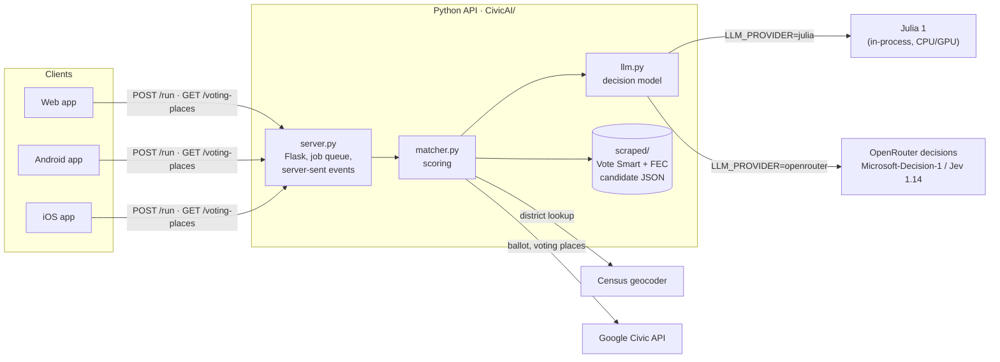

# CivicMatchmaker

A non-partisan app that matches voters with the candidates on their ballot. You answer a short questionnaire about the issues you care about, and CivicMatchmaker compares your answers with each candidate's recorded positions. It then shows who agrees with you most, and why.

It runs on **web, Android and iOS** from one Expo / React Native codebase. A small Python API does the matching.

## Features

- **Issue questionnaire.** 23 statements across 12 topics: taxes, healthcare, energy, immigration, voting and more. Answers use a 1–5 agree/disagree scale, and you can mark how important each one is to you.
- **Location-aware.** Your state and address narrow the list to the races you can vote in. The address is turned into a U.S. House district with the free Census geocoder.
- **Explained matches.** Each candidate gets an overall score, a score per topic, and the statements that drove the score.
- **Sample ballot.** Shows local and state races and ballot measures from the Google Civic Information API, when Google has data for that address.
- **Where to vote.** Ballot drop boxes, early-voting sites and Election Day polling places on a map, with Leaflet/OpenStreetMap on web and Android and Apple Maps on iOS.
- **Learn how to vote.** State-specific voting guidance.

## Architecture



The app runs in one of two modes, set by `APP_ENV` in `.env`:

| | `APP_ENV=local` | `APP_ENV=hosted` |
|---|---|---|
| API server | Your computer (`python main.py`) | Render free web service (`render.yaml`) |
| Decision model | **Julia 1** in-process, or **OpenRouter** with `LLM_PROVIDER=openrouter` | **OpenRouter** decision model (`microsoft/microsoft-decision-1` by default) |
| Web app | Expo dev server | Static export on a free Render Static Site (`render.yaml`) |
| Android / iOS | Expo Go, talking to your computer over Wi-Fi | Expo Go from your dev server, talking to the deployed API |

Both decision models answer the **same classification questions in the same format**: `{state, questions}` in, `{choice, probabilities}` out. The matching code doesn't depend on which one is running.

In hosted mode, both run on Render's free plan from one Blueprint (`render.yaml`):

```
https://civicmatchmaker-web.onrender.com/   -> web app (dist/)        HOSTED_URL
https://civicmatchmaker-api.onrender.com/   -> Python API (CivicAI/)  BACKEND_URL
```

The web app calls the API directly (the API sends CORS headers). Only the web app is deployed. The mobile app always runs from your Expo dev server in Expo Go.

## How matching works

1. **Direct matches (no model).** Most app statements are worded to mirror a question from Vote Smart's *Political Courage Test* (`DIRECT` in `matcher.py`). For those, the candidate's Yes/No answer is used as-is.
2. **Model matches.** For other statements, the decision model is asked three narrow multiple-choice questions:
   - **route:** which of the candidate's positions is about the same issue?
   - **same issue:** is it really the *same* specific issue? This second check rejects near misses.
   - **direction:** does "yes" to that position agree or disagree with the statement?

   Free-text answers such as "Yes, with conditions" are also classified as supports, opposes or mixed.
3. **Scoring is plain arithmetic.** Agreement between your 1–5 answer and the candidate's stance is weighted by:
   - the model's confidence,
   - how strongly you feel,
   - how important you said the question is.

   The result is an overall score, per-topic scores and the top three reasons.
4. **Unscored candidates still appear.** Candidates on your ballot without recorded positions are listed so nobody silently disappears. These come from the FEC registry and the Google Civic ballot.

## Repository layout

```
.env.example            configuration template (copy to .env)
scripts/app.js          npm start | web | android | ios | server
src/                    Expo app (Expo Router)
  app/                  screens: index → locationSelect → questions → results → ballot / dropoff / learn
  components/           Screen, PrimaryButton, VotingMap (native + web), PartyStripe
  constants/            questions, colours, API URL
  lib/                  API clients (matchApi, votingPlacesApi), web-only setup
CivicAI/                Python API server
  main.py               entry point: python main.py
  config.py             every setting, read from .env
  server.py             Flask app: job queue + server-sent events
  matcher.py            scoring and the decision-model questions
  llm.py                decision model backends: julia | openrouter
  candidates.py         load candidate files, classify offices
  location.py           state codes, Census district lookup
  ballot.py             Google Civic ballot races and measures
  voting_places.py      drop-off / early vote / polling places
  sample_candidates.py  demo data, used when scraped/ is empty
  scraped/              candidate data (Vote Smart positions + FEC registry)
  scraper/              scripts that refresh scraped/
  diagnose.py           why does a candidate have few matches?
  test_match.py         run the matcher without the app
  Dockerfile            API image for Render (hosted mode)
render.yaml             Render Blueprint for the hosted API server and web app
```

## Configuration

All configuration is in **one file, `.env`, at the repo root.** It is gitignored. Start from the template:

```bash
cp .env.example .env
```

| Key | Needed for | Description |
|---|---|---|
| `APP_ENV` | always | `local` or `hosted` |
| `LLM_PROVIDER` | optional | `julia` or `openrouter`. Empty means local uses `julia` and hosted uses `openrouter` |
| `JULIA_MODEL_DIR`, `JULIA_DEVICE` | local | Julia 1 model folder (relative to `CivicAI/`) and `cpu` / `cuda` |
| `OPENROUTER_API_KEY` | OpenRouter | OpenRouter API key (local with `LLM_PROVIDER=openrouter`; set it in Render for hosted) |
| `OPENROUTER_MODEL` | OpenRouter | `microsoft/microsoft-decision-1` (default) or `typesafe/jev-1.14` |
| `GOOGLE_CIVIC_API_KEY` | optional | Turns on sample ballots and voting places |
| `BACKEND_URL` | hosted | Your Render API URL, e.g. `https://civicmatchmaker-api.onrender.com` |
| `HOSTED_URL` | hosted | Your Render web app URL, e.g. `https://civicmatchmaker-web.onrender.com`. Used for the web QR code |
| `PORT`, `MAX_CONCURRENT`, `MAX_QUEUED`, `DEBUG` | optional | Server tuning. `DEBUG=1` prints every pairing the model makes |

How the values are used:
- **Real environment variables override `.env`.**
- **Only the API URL reaches the app.** Expo only bundles `EXPO_PUBLIC_*` variables, so no key from `.env` ends up in the app.
- **The scripts set the API URL for you.** `scripts/app.js` sets `EXPO_PUBLIC_API_URL` from the mode.

## Run locally (`APP_ENV=local`)

Prerequisites: Node 20+ and Python 3.11+. To use Julia 1, you also need the downloaded **`CivicAI/Julia-1/`** model folder. It is about 600 MB and gitignored.

```bash
npm install

# Python API (one time)
cd CivicAI
python3 -m venv .venv
.venv/bin/pip install -r requirements-julia.txt   # Flask + Julia 1 (torch, transformers)
cd ..
```

Then choose a platform. Each command starts the API server if it isn't already running, then opens the app pointed at it. Once Metro is up it prints two QR codes: **Web** (the dev web app at `http://<LAN IP>:8081`) and **App** (`exp://<LAN IP>:8081` for Expo Go).

```bash
npm start         # dev server only: open web / Android / iOS from the QR codes
npm run web       # browser
npm run android   # Android emulator or Expo Go on your phone
npm run ios       # iOS simulator (macOS); on Linux/Windows scan the QR code with Expo Go
npm run server    # API server only
```

- **Use `npm start`, not `npx expo start`.** Only the npm scripts start the API server, set the API URL and print the web QR code. Extra flags pass through to Expo, e.g. `npm start -- -c` to clear the bundler cache.
- **Expo Go must match the SDK.** The project is on Expo SDK 58, so install the current Expo Go from the store.
- **Phones and emulators** reach the server through your computer's LAN IP, which is detected automatically. Keep them on the same Wi-Fi.
- **Native builds:** add `-- --native` to build and run the native app (`expo run:android|ios`) instead of using Expo Go.
- **OpenRouter instead of Julia 1:** set `LLM_PROVIDER=openrouter` and add an `OPENROUTER_API_KEY`. Then install only `requirements.txt`, which needs no torch.

## Hosted mode: everything on Render (free)

**1. Deploy (one time).** Push the repo to GitHub, then in the Render dashboard choose **New → Blueprint** and pick the repo. `render.yaml` creates two services:
- `civicmatchmaker-api`, built from `CivicAI/Dockerfile`. Enter `OPENROUTER_API_KEY` (and optionally `GOOGLE_CIVIC_API_KEY`) when asked.
- `civicmatchmaker-web`, a static site built with `npx expo export -p web`. Its `EXPO_PUBLIC_API_URL` is set in `render.yaml` to `https://civicmatchmaker-api.onrender.com`. If Render gives the API a different URL, change it there and redeploy the site.

After that, every push redeploys both. Put the two URLs in `.env` (`BACKEND_URL` for the API, `HOSTED_URL` for the site), then check the API:

```bash
curl "$BACKEND_URL/status"   # {"provider": "openrouter", ...}
```

**2. Phones against the deployed API.** Set `APP_ENV=hosted` and run `npm start`. Expo Go uses `BACKEND_URL`, and the Web QR code points at `HOSTED_URL`.

Notes:
- **Cold start.** Render's free instance sleeps after 15 idle minutes, and the next request takes about a minute to wake it.
- **One instance.** The server keeps its job queue in memory, so it runs as a single instance.

## Choosing the decision model

| Model | Where | Notes |
|---|---|---|
| **Julia 1** (Supersonic Labs) | local, in-process | No API costs. CPU works but is slow, about 4 min for `test_match.py` |
| **Microsoft-Decision-1** (`microsoft/microsoft-decision-1`) | OpenRouter | Default for hosted. About 0.7 s per call and about $0.000003 per call. Its results are close to Julia 1's |
| **Jev 1.14** (`typesafe/jev-1.14`) | OpenRouter | Stricter on the "same issue?" check, so fewer model-based matches. About 5 s per call |

- **Switch with one line:** `OPENROUTER_MODEL=...` in `.env`, then redeploy for hosted.

## Refreshing candidate data

`CivicAI/scraped/` holds the candidate data, and the scripts in `CivicAI/scraper/` refresh it:
- **FEC registry:** federal candidates from the FEC, written to `candidates.json`.
- **Vote Smart answers:** Political Courage Test answers, one `<id>.json` file per candidate.

```bash
cd CivicAI
.venv/bin/pip install -r scraper/requirements.txt
export FEC_API_KEY=...                                 # free: https://api.data.gov/signup/
.venv/bin/python scraper/midterms.py --all-states      # FEC candidates -> candidates.json
.venv/bin/python scraper/midterms.py --pct-only --cookie-file scraper/cookie.txt
                                                       # link + scrape Vote Smart answers
```

See the docstrings at the top of `scraper/midterms.py` and `scraper/pct_scraper.py` for every option.

The server reads the files once at startup:
- **Local:** restart the server after refreshing.
- **Hosted:** push to GitHub; Render rebuilds the image with the new data.

## Developer commands

```bash
npm run lint                         # ESLint (Expo config)
npm run typecheck                    # TypeScript
npx expo-doctor                      # dependency / config check

cd CivicAI
.venv/bin/python test_match.py       # run the matcher on a sample voter (DEBUG=1 for detail)
.venv/bin/python diagnose.py bennet  # why does a candidate have few matches?
```

## API reference

| Endpoint | Description |
|---|---|
| `POST /run` | Body: `{state, city, address?, zip?, answers: [{id, section, type, question, answer, weight?}]}`. Responds with a `text/event-stream` |
| `GET /voting-places?address=&city=&state=&zip=` | Drop-off, early voting and polling places as JSON |
| `GET /status` | Queue size, mode, decision model and number of candidates loaded |

`/run` streams these events:

| Event | Meaning |
|---|---|
| `queued` | `{position}`: waiting for a free worker |
| `started` | A worker picked up the job |
| `progress` | `{done, of, candidate}` |
| `result` | The final `{matches, answered, location, ballot}` |
| `error` | `{message}` |

Closing the connection cancels the job.

## Security

- **Never commit secrets.** `.env` (and any local `secrets` file) holds real keys. Both are gitignored, so keep it that way.
- **Restrict or rotate the Google Maps key.** `app.json` contains a Google Maps API key (`iosGoogleMapsApiKey`) in plain text. Restrict it to the app's bundle ID in the Google Cloud console, or rotate it and supply it at build time.

## License

MIT, see [LICENSE](LICENSE).
